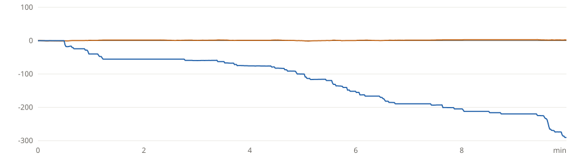

# tickwire

An honest market-making simulator on checksum-verified Kraken order books, written in OCaml.

It keeps exact local copies of Kraken's order books, proves them correct against the exchange's own checksums on every update, records sessions, replays them deterministically, and runs the same simple market-making strategy through a **naive** backtest and an **honest** simulation (queue position, latency, fees). The report is about the gap between the two.

Public market data only. It never authenticates and contains no order-placement code.

## The result

The same textbook strategy, on the same ten minutes of recorded BTC/USD and ETH/USD (2026-11-14, 15:31 to 15:41 UTC), under two sets of rules:

| | Naive backtest | Honest simulation |
|---|---:|---:|
| Fills | 76 | 119 |
| Gross P&L, marked to mid | **+$2.98** | −$7.23 |
| Maker fees at 0.40% | ignored | $476.90 |
| What each model reports | **+$2.98** | **−$484.13** |
| Mid move 10 s after a fill, BTC/USD | −2.27 bp | −1.70 bp |
| Mid move 10 s after a fill, ETH/USD | −1.83 bp | −1.96 bp |

**Naive says +$2.98. Honest says −$484.13.**

- **Queue, latency and stale quotes: −$10.21.** The honest simulation gets *more* fills here, not fewer. With 100 ms each way, quotes that the naive model has already moved are still resting at the exchange when the market runs through them. In both models the mid moves about 2 bp against a fill within ten seconds, which eats most of the 3 bp the quote was meant to earn, so extra fills are not extra profit.
- **Fees: −$476.90.** At the 0.40% maker fee a new Kraken account pays, each fill costs about 40 basis points to capture a spread of about 3. At the 0% maker tier the honest result would be its gross figure, −$7.23.



*P&L over the ten minutes for BTC/USD, in dollars: naive, gross (orange) and honest, net of fees (blue).*

Ten minutes is a small sample and the strategy's settings were picked on this same data, so the dollar figures mean little; the size and direction of the gap are the point. A full example report is in [docs/example-report.html](docs/example-report.html).

The data underneath is verified: over that session all 316,672 book updates matched Kraken's checksums, with no resyncs.

## Build

Requires [opam](https://opam.ocaml.org/) 2.2 or later. On Windows, opam installs its own mingw-w64 toolchain.

```
opam switch create tickwire ocaml-base-compiler.5.4.1
opam install --switch=tickwire --deps-only --with-test .
opam exec --switch=tickwire -- dune build
opam exec --switch=tickwire -- dune test
```

On Windows 11, Smart App Control blocks locally built, unsigned executables, including the toolchain's linker. It has to be off to build and run this.

## Run

Everything in one command:

```
_build\default\bin\main.exe nightly
```

This captures 60 minutes of live data, verifies every update, records it, runs both simulations and writes `reports\YYYY-MM-DD\report.html`. Use `--minutes 5` for a quick run. The exit code is 2 if the data did not verify 100%.

| Command | What it does |
|---|---|
| `nightly [--minutes N]` | Capture, verify, record, simulate, report. |
| `live [--minutes N] [--record]` | Maintain verified live books and print checksum statistics. |
| `replay FILE` | Replay a recording through the live code path and re-verify every checksum. |
| `sim FILE [--report out.html]` | Run both simulations over a recording and write a report. |
| `probe [SECONDS]` | Print raw Kraken book messages (connectivity check). |

Main options (`main.exe nightly --help` lists all):

| Option | Default | Meaning |
|---|---|---|
| `--symbols` | `BTC/USD,ETH/USD` | Symbols to follow. |
| `--depth` | `25` | Book levels per side. |
| `--latency-ms` | `100` | Order latency each way. |
| `--half-spread-bps` | `3` | Distance of each quote from the mid. |
| `--skew-bps` | `1` | Quote shift per order of inventory held. |
| `--order-usd` | `1000` | Size of each quote. |
| `--max-inventory` | `5` | Inventory cap, in orders. |
| `--cancel-model` | `prorata` | Or `pessimistic`. |
| `--fee-tier` | `1` | Kraken Pro spot fee tier, 1 to 17. |
| `--maker-fee-bps` | | Set the maker fee directly. |
| `--keep-days` | `14` | Delete recordings older than this. |

To run it every night on Windows, `scripts\register-nightly-task.ps1` registers a Task Scheduler job (daily at 02:00 by default; `-At` and `-Minutes` change that):

```
powershell -ExecutionPolicy Bypass -File scripts\register-nightly-task.ps1
```

Recordings take roughly 400 to 650 MB per hour of capture and are kept for 14 days by default, in `data\`.

## How it is tested

- Kraken's documented checksum example is reproduced exactly, directly and through the full feed handler.
- Property tests on the book: never crossed after valid data, levels sorted, zero-quantity levels removed, agreement with a naive model.
- A committed 90-second recording replays with every checksum matching; two replays produce identical output hashes; dropping updates from it is detected by the checksum and triggers a resync.
- Every fill rule of the honest model has a hand-built scenario, run against both a simple reference implementation and the optimised one; the two also agree event by event on thousands of randomised streams.
- Simulation and report output on the fixture are byte-identical across runs and pinned by hash.

## Limitations

- **No market impact.** The recorded market does not react to simulated orders. This flatters both models, so the honest figure is still an upper bound.
- **Cancellations are an assumption.** The data does not say where in the queue a cancel happened; pro-rata and pessimistic bracket it.
- **Fixed latency**, no jitter.
- **The book channel has no sequence numbers,** so a lost message is detectable only through the checksum.
- Short runs are noise. The defaults were chosen on one ten-minute sample.

## More

- [docs/HOW_IT_WORKS.md](docs/HOW_IT_WORKS.md): plain-English explanation and every modelling assumption.
- [docs/DESIGN.md](docs/DESIGN.md): design choices and their alternatives.

## Licence

MIT. See [LICENSE](LICENSE).
